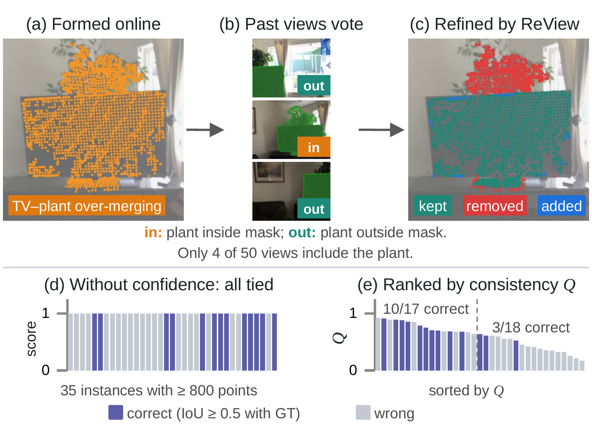

# ReView: Online Zero-Shot 3D Instance Segmentation by Revisiting Past Views

**Yuanyang Zhang<sup>1</sup>, Li Yao<sup>1</sup>, Yijie Lin<sup>2</sup>, Xinchao Wang<sup>3</sup>**

<sup>1</sup>Southeast University &nbsp; <sup>2</sup>The Hong Kong University of Science and Technology &nbsp; <sup>3</sup>National University of Singapore

[**Project page**](https://zhangyuanyang21.github.io/ReView-3DIS/) | arXiv (coming soon) | Code (coming soon) | [Video](static/videos/ReView_video.mp4)



ReView is a training-free framework for online zero-shot 3D instance segmentation. At query time, it revisits
accumulated instances using only the observations collected so far, without changing the online association process:

- **View-consensus refinement**: best-matching 2D masks from past views vote on visible points, removing wrongly
  included points and adding missing ones before connectivity cleanup.
- **Observation-consistency confidence**: the same matches are averaged across all valid views to rank instances.
- **Track-based recovery**: temporal mask tracks provide candidates for missed objects after overlap checks and
  duplicate suppression.

Experiments on ScanNet200 and SceneNN show that ReView achieves the highest AP among the compared online and offline
methods (OnlineAnySeg's released evaluation script).

## News

- The paper will be available on arXiv soon.
- Code will be released in this repository.

## Citation

```bibtex
@article{zhang2026review,
  title   = {ReView: Online Zero-Shot 3D Instance Segmentation by Revisiting Past Views},
  author  = {Zhang, Yuanyang and Yao, Li and Lin, Yijie and Wang, Xinchao},
  journal = {arXiv preprint},
  year    = {2026}
}
```

## Contact

Yuanyang Zhang (zhangyuanyang@seu.edu.cn)
